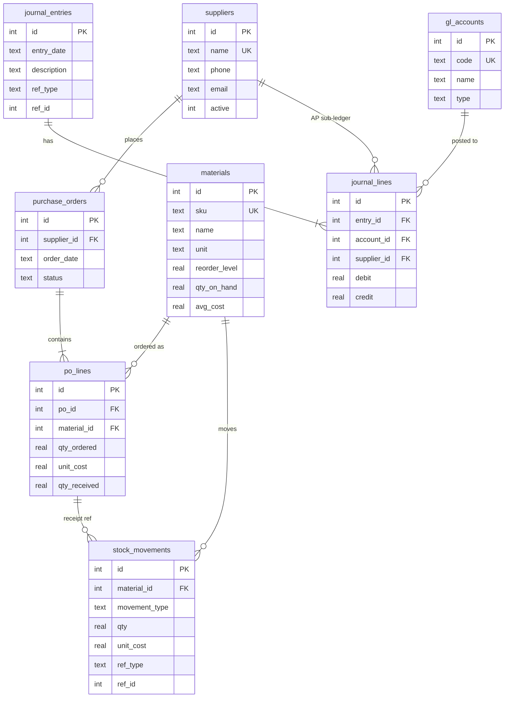

# Sebo Foods ERP Prototype (Materials Management + Financials)
   [Live Demo](https://sebo-foods-erp-2.onrender.com)
   Hosted on Render’s free tier. The first load may take 30-60 seconds, and demo data resets if the app restarts
Midterm project: Generative AI-Assisted ERP System Design.
A lightweight ERP for a food-manufacturing company. Two integrated modules share **one** SQLite database:

- **Materials Management (MM):** suppliers, raw-material master, purchase orders, goods receipts, issues to production, stock ledger, reorder alerts.
- **Financials (FI):** chart of accounts, double-entry general ledger, accounts payable per supplier, supplier payments, trial balance.

## Setup (Python 3.8+, no external packages)

```bash
python app.py --demo     # scripted walkthrough (recreates the database)
python web.py            # WEB DASHBOARD -> open http://127.0.0.1:8000 (creates sebo_erp.db on first run)
python app.py            # interactive CLI menu (same database)
python test_erp.py       # 11 automated tests of the integrity rules
```

To reset the data, delete `sebo_erp.db`.

## Web dashboard

`python web.py` starts a local server (Python standard library only) with six screens: Dashboard (KPIs, reorder alerts, integrity checks, recent journal postings), Suppliers, Materials (with stock ledger), Purchasing (create PO, receive goods, cancel), Production issue, and Financials (pay supplier, trial balance, supplier balances). The dashboard calls the same functions in `app.py`, so the web and CLI share one set of business rules and one database. Set `PORT=9000` to change the port.

## How the modules integrate (data flow)

| Business event (MM) | Stock effect | Financial posting (FI), same transaction |
|---|---|---|
| Receive goods against a PO line | + quantity, moving-average cost recalculated | Dr 1200 Inventory / Cr 2100 Accounts Payable (tagged with supplier) |
| Issue material to production | - quantity (blocked if stock would go negative) | Dr 5000 Raw Materials Consumed / Cr 1200 Inventory (at average cost) |
| Pay supplier (FI) | none | Dr 2100 Accounts Payable / Cr 1000 Cash |

Each event runs in one database transaction, so stock, stock ledger and general ledger either all update or none do.

## Single source of truth: how it is enforced

- No stored balances. Stock value, supplier balances and the trial balance are **views** derived from the ledgers (`v_trial_balance`, `v_ap_balance`), so there is nothing to fall out of sync.
- `materials.qty_on_hand` and `avg_cost` can only change through `stock_movements` (database triggers); the app cannot edit them directly.
- Constraints: `UNIQUE` on supplier name, material SKU and account code; `CHECK` for non-negative stock, positive quantities, no over-receipt (`qty_received <= qty_ordered`), debit-xor-credit per journal line; foreign keys with `RESTRICT` so used suppliers/materials cannot be deleted.
- Double entry: the posting engine rejects any journal where debits differ from credits; `v_unbalanced_entries` audits this.
- Append-only ledgers: triggers block UPDATE/DELETE on `stock_movements` and `journal_lines`.
- Reconciliation: `v_inventory_vs_gl` compares stock value to the GL inventory account (menu option 19).

## CRUD coverage

| Entity | Create | Read | Update | Delete |
|---|---|---|---|---|
| Suppliers | yes | yes | yes | yes (blocked if it has history; deactivate instead) |
| Materials | yes | yes | yes (not qty/cost) | yes (blocked if it has history) |
| Purchase orders | yes | yes | receive / cancel | cancel (status), not physical delete |
| Journal / stock ledgers | via business events | yes | no (audit) | no (audit) |

## ER diagram



## Known limitations (honest scope)

Single user, no login/roles (the dashboard listens on localhost only), SQLite (single writer), one currency (UGX), one warehouse, no VAT/tax, no supplier-invoice matching (invoice assumed = goods receipt value), no reversal screens. See the reflection for scaling discussion.

## Files

`schema.sql` DDL, constraints, triggers, views | `seed.sql` chart of accounts and sample data | `app.py` service layer + CLI | `web.py` web dashboard | `test_erp.py` tests | `PROMPT_LOG.md` and `AI_SUPPORT_STATEMENT.md` AI documentation (student to complete)
